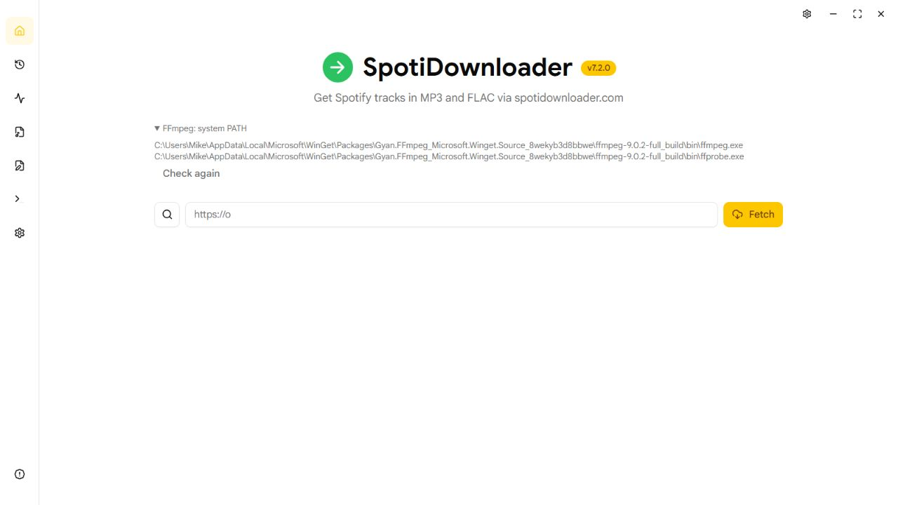

# Исправления по аудиту — 8 октября 2026

Исправлены F01–F10 из [исходного отчёта](2026-10-08-project-audit.md).
Изменения находятся в рабочей копии; коммит и публикация не выполнялись.

По последующему уточнению пользователя блок с найденными путями FFmpeg удалён с
главного экрана. Успешная проверка проходит незаметно; окно установки и причина
ошибки показываются только при отсутствии рабочей пары. Снимок ниже сохраняет
историческое подтверждение обнаружения PATH до удаления диагностического блока.

| Замечание | Что исправлено | Проверка |
| --- | --- | --- |
| F01 · FFmpeg | Общий поиск рабочей переносимой пары, затем FFmpeg из PATH и FFprobe рядом с ним. Все потребители используют этот поиск; проверки версий ограничены временем. Интерфейс показывает источник, пути и причину отказа, позволяет повторить проверку. | Тесты приоритета, отсутствующих/нерабочих/разнесённых бинарников и отмены; живой запуск нашёл WinGet FFmpeg 9.0.2 и FFprobe без установки. |
| F02 · Принудительный повтор | `force` обходит пропуск существующего файла во frontend; backend сохраняет безопасную замену через staging. | Регрессия существующий файл → terminal → retry → вызов загрузки с force; существующие тесты публикации backend. |
| F03 · Сброс очереди | Отдельные команды очистки истории, остановки и новой сессии. Новая сессия отменяет и дожидается операций, затем очищает оба представления и сводки; заголовок больше не сбрасывает очередь. | Тесты порядка отмены/регистрации/очистки и запрета добавления во время reset; Go-тест отмены активной работы при ClearAllDownloads. |
| F04 · Настройки | Ошибка записи возвращается экрану; кэш и события обновляются после успеха. Форма остаётся несохранённой при отказе; новые правки во время save сохраняются. JSON записывается через временный файл, sync и атомарную замену. | Тесты отказов save/reset/defaults, изменений во время save, TitleBar и атомарной записи/очистки временного файла. |
| F05 · Поиск | Запоздавшие ответы и ошибки отбрасываются по поколению запроса. Пагинация связана с запросом и вкладкой. Ожидание, пустая выдача и ошибка имеют разные состояния; ошибки можно повторить. | Тесты реального React-компонента: смена/очистка запроса, смена режима/вкладки, поздний resolve/reject, ошибки и повтор пагинации. |
| F06 · Отмена Windows | Абсолютный путь к taskkill, предел 3 секунды и резервная отмена дерева через Windows API. Сроки тестовых ожиданий учитывают завершение дерева и закрытие pipe. | Все ранее падавшие проверки отмены прошли; дополнительные тесты отсутствующего, зависшего и ошибочного taskkill проверяют завершение потомков. |
| F07 · Общая очередь | Ожидающие frontend-задания объединяются с backend-деталями по идентификаторам и принадлежности очереди. Сохранены понятные обозначения suspicious/unavailable и отдельные команды остановки. | Тесты объединения ожидающих строк, принадлежности деталей и реальных кнопок интерфейса. |
| F08 · Один трек | Занятость и результат берутся из последней попытки конкретного трека. Чужая очередь не блокирует кнопку. | Тест React-компонента с занятой посторонней очередью и собственными queued/terminal-попытками. |
| F09 · StrictMode | Отложенное освобождение различает повтор эффекта StrictMode и настоящий unmount. | Настоящее монтирование React StrictMode, постановка задания после replay и освобождение после unmount. |
| F10 · Производительность | Пакетное добавление с индексом последних попыток; единый источник прогресса, 200 мс при работе и 1 секунда в простое, без перекрывающихся запросов. Разделены страницы и библиотеки сборки. | Тесты ограниченного числа публикаций, общих подписчиков и медленных запросов; production build без предупреждения о чанках >500 КБ. |

Дополнительно:

- Общий построитель каталогов для аудио, обложек и текстов учитывает настройки папки плейлиста, даты, диски и номера треков. Тесты проверяют реальные запросы одиночных и пакетных sidecar-загрузок.
- Очистка истории сохраняет пути M3U8; добавленные позже файлы остаются в правильном порядке. Новая сессия очищает эти пути и сводки.
- Исправлена регистрация callback для отмены правок в настройках: функция сохраняется в ref, а не выполняется как updater состояния.
- Добавлены доступные имена кнопок навигации/треков/закрытия; фильтры очереди доступны с клавиатуры и показывают `aria-pressed`.
- Устранены четыре предупреждения exhaustive-deps. Добавлены проверки pull request и обязательная проверка перед release-сборками.
- README теперь соответствует Go 1.26.4, Node 24, pnpm 10.30.2 и фактическим форматам загрузки. [ROADMAP](../../ROADMAP.md) отделяет реализованное от будущих идей.

## Итоговая проверка

- `go test ./... -count=1`: **286 прошли**.
- Frontend Vitest: **169 тестов, 22 файла — все прошли**.
- `tsc -b`, ESLint с `--max-warnings 0`, `go vet ./...`, `git diff --check`: успешно.
- Сгенерированы Wails bindings; собрана Windows production-сборка `build/bin/SpotiDownloader.exe`.
- После проверки завершён отладочный запуск и запущен собранный `SpotiDownloader.exe`.
- Главный JS-файл: **864 → 302 КБ** (gzip примерно **252 → 78 КБ**); библиотеки вынесены в отдельные файлы, остальные страницы загружаются по требованию. Общий объём всех библиотек не исчезает.
- Локальное измерение добавления 2000 заданий: около **1053 → 7 мс**. Сравнение отражает замену прежнего цикла enqueue на используемый приложением enqueueMany; это локальное измерение, не гарантия для любого компьютера.
- Живой интерфейс проверен через Wails dev-сервер с настоящим Go backend и итоговым production frontend: системная пара FFmpeg, Settings, анализатор, конвертер, файловый менеджер, история, About и журнал. Проверены предупреждение о несохранённых изменениях, отмена перехода и возврат после удаления собственного тестового ввода.

## Границы проверки

Реальные загрузки Spotify/YouTube и внешние API, полноценный экранный диктор/контраст,
нативный захват Windows-окна и запуск macOS/Linux не проверены. Снимок сделан в браузере,
а не в настольном окне. Новый CI описывает проверенные локально команды; запуск на GitHub
ещё не выполнялся.

Резервная отмена Windows получает снимок существующих потомков: процесс, создающий новых
потомков одновременно с отменой, может попасть в гонку. Ограничение отмечено `ponytail:`
в коде; текущие помощники и тесты отмены проходят, для такого сценария потребуется Job Object.

Дополнительный выбор произвольной папки FFmpeg, сохранение очередей между запусками,
локализация и другие идеи развития не добавлялись: они не нужны для устранения найденных
ошибок и перечислены отдельно в roadmap.
