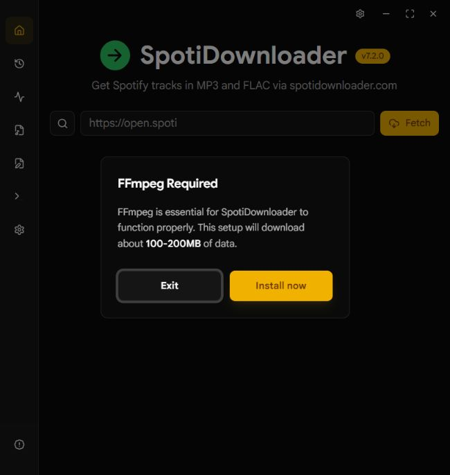

# Аудит SpotiDownloader — 8 октября 2026

Проверена рабочая копия на коммите `1088d16`. Аудит охватывает пользовательский путь загрузки, очередь, настройки, планы развития и локальные проверки качества. Изменений в исходники приложения не внесено.

Основной вывод: фундамент загрузок уже реализован, но несколько разрывов между интерфейсом и исполнением мешают пользоваться им надёжно. Первым стоит исправить обнаружение FFmpeg, затем принудительный повтор, сброс очереди и сообщения о сохранении. Новые большие функции лучше добавлять после этих исправлений.

## Что проверено и где границы

Собраны текущий frontend и Windows-приложение. Живой интерфейс открыт через локальный dev-сервер Wails с настоящим Go backend и текущим production frontend, без подмены данных. Захват настольного окна не сработал: две попытки завершились тайм-аутом. Снимок ниже получен через встроенный браузер, сохранён и проверен.

1. **Запуск и проверка зависимостей — блокирующая проблема.** Установленные системные FFmpeg и FFprobe доступны в PATH, но приложение предлагает установку ещё одной копии. В окне только Exit и Install now.
2. **Ввод ссылки и поиск — живая проверка заблокирована шагом 1.** Код проверен; обнаружены риски запоздавших результатов и некорректного сообщения при сетевой ошибке.
3. **Выбор треков и добавление загрузок — живая проверка заблокирована шагом 1.** Планировщик проверен существующими тестами; отдельно воспроизведён сбой принудительного повтора.
4. **Очередь и результаты — живая проверка заблокирована шагом 1.** Проверены связи frontend/backend, операции очистки и прогресс; найдены несогласованные представления очереди.
5. **Настройки и повторный запуск — живая проверка заблокирована шагом 1.** Отдельно воспроизведено подавление ошибки записи настроек. Перезапуск выполнен по просьбе пользователя.

Это технический аудит с частичной проверкой живого интерфейса. Полный визуальный аудит остальных экранов, клавиатурная навигация, экранный диктор, контраст и реальные загрузки из внешних источников не проверены. Скриншот браузера не используется для выводов о размере или адаптивности настольного окна.

## Приоритетные проблемы

### F01 · P1 · Системный FFmpeg не обнаруживается

**Подтверждение:** `ffmpeg -version` успешно выполняется; `ffmpeg.exe` и `ffprobe.exe` найдены в установленном пакете WinGet. В переносимой папке приложения их нет. На живом экране появляется FFmpeg Required.

`GetFFmpegPath` и `GetFFprobePath` всегда строят путь к `SpotiDownloader.runtime/bin`. `IsFFmpegInstalledContext` проверяет только этот путь. В PATH приложение не ищет. Поэтому фраза «FFmpeg Required» не объясняет реальное состояние: FFmpeg есть, но приложение его игнорирует.

Источники: [backend/ffmpeg.go:84](F:/Data/Code/JavaScript/SpotiDownloader/backend/ffmpeg.go:84), [app_runtime.go:86](F:/Data/Code/JavaScript/SpotiDownloader/app_runtime.go:86), [App.tsx:603](F:/Data/Code/JavaScript/SpotiDownloader/frontend/src/App.tsx:603).

**Рекомендация:** единый resolver для FFmpeg/FFprobe: рабочая переносимая пара → рабочая пара из PATH → явно выбранная пользователем папка → установка. В интерфейсе показывать источник, путь и причину неудачной проверки. Установка должна оставаться явным действием. Проверка при запуске и все операции конвертации, анализа и YouTube должны пользоваться одним resolver; исправить только стартовый флаг недостаточно.

Поддержка системных бинарников расширяет прежний план переносимого runtime. Установленные самим приложением помощники, кэш и временные файлы по-прежнему можно хранить рядом с executable.

### F02 · P1 · Принудительный повтор пропускает уже существующий файл

**Подтверждение:** отдельное воспроизведение добавило трек с существующим файлом, дождалось `skipped` и вызвало повтор. Новая попытка имела `force=true`, но снова стала `skipped`; `downloadTrack` не вызывался.

Планировщик правильно устанавливает force. Однако `executeSpotify` обрабатывает `existingFilePath` раньше вызова backend и не учитывает force. Backend умеет безопасно заменять файл, но до него запрос не доходит.

Источники: [useDownloadQueues.ts:281](F:/Data/Code/JavaScript/SpotiDownloader/frontend/src/hooks/useDownloadQueues.ts:281), [download-queue-manager.ts:308](F:/Data/Code/JavaScript/SpotiDownloader/frontend/src/lib/download-queue-manager.ts:308), [track_pipeline.go:205](F:/Data/Code/JavaScript/SpotiDownloader/backend/track_pipeline.go:205).

**Рекомендация:** существующий файл должен приводить к skip только при `!job.force`. Добавить сквозной тест «terminal attempt → retry → existing file → реальный вызов с force → staged replacement».

### F03 · P1 · Сброс очереди очищает только backend-представление

**Подтверждено по коду; в живом интерфейсе операция не выполнялась.** Нажатие заголовка Download Queue вызывает `ClearAllDownloads`. Backend очищает список прогресса, но не отменяет активные контексты и не очищает frontend scheduler.

Загрузки могут продолжаться при исчезнувших строках прогресса. Планировщик при этом сохраняет попытки и свою политику «уже представленных» треков. Операция неожиданно скрыта в заголовке, не в отдельной кнопке.

Источники: [DownloadQueue.tsx:33](F:/Data/Code/JavaScript/SpotiDownloader/frontend/src/components/DownloadQueue.tsx:33), [DownloadQueue.tsx:120](F:/Data/Code/JavaScript/SpotiDownloader/frontend/src/components/DownloadQueue.tsx:120), [app_queue_history.go:123](F:/Data/Code/JavaScript/SpotiDownloader/app_queue_history.go:123), [progress.go:555](F:/Data/Code/JavaScript/SpotiDownloader/backend/progress.go:555).

**Рекомендация:** определить отдельные понятные операции «очистить завершённые записи», «остановить очередь», «начать новую сессию». Последняя должна согласованно менять scheduler и backend. Заголовок оставить заголовком. Очистка истории загрузок не должна случайно отменять работу или маскировать активные попытки.

### F04 · P1 · Ошибка сохранения выглядит как успех

**Подтверждение:** в воспроизведении backend отклонил сохранение с ошибкой записи, но `saveSettings` вернул успешно завершённый Promise. Экран затем безусловно вызывает `toast.success("Settings saved")` и снимает признак несохранённых изменений.

Кроме того, кэш и localStorage меняются до подтверждения записи на диск. Backend сохраняет конфиг прямым `os.WriteFile`, поэтому устойчивость к прерыванию записи тоже стоит улучшить.

Источники: [settings.ts:331](F:/Data/Code/JavaScript/SpotiDownloader/frontend/src/lib/settings.ts:331), [SettingsPage.tsx:80](F:/Data/Code/JavaScript/SpotiDownloader/frontend/src/components/SettingsPage.tsx:80), [app.go:477](F:/Data/Code/JavaScript/SpotiDownloader/app.go:477).

**Рекомендация:** возвращать ошибку вызывающему экрану, сохранять признак несохранённых изменений при отказе, показывать причину. Фиксировать кэш после успешного сохранения либо явно описать режим временных настроек. Конфиг писать через временный файл и атомарную замену.

### F05 · P2 · Поиск смешивает запоздавшие ответы и сетевые ошибки с пустой выдачей

**Подтверждено по коду; гонка на реальном API не воспроизводилась.** Debounce отменяет только ещё не запущенный таймер. Начатый запрос не защищён номером поколения. Более старый ответ может перезаписать новый; очистка строки тоже не защищена от уже начатого запроса. Load More имеет аналогичный риск при смене запроса.

В `catch` результат сбрасывается в null. Затем интерфейс показывает No results found, хотя причиной может быть сеть или отказ сервиса. Сообщение об отсутствии результатов также может появляться до начала запроса во время debounce.

Источник: [SearchBar.tsx:102](F:/Data/Code/JavaScript/SpotiDownloader/frontend/src/components/SearchBar.tsx:102).

**Рекомендация:** хранить request generation и применять ответ только к актуальному запросу; использовать состояния idle/debouncing/loading/success/empty/error. Для ошибки дать повтор и объяснение. Пагинацию привязать к запросу и вкладке, которые её начали.

### F06 · P1 для проверки релиза · Отмена процессов в Windows не проходит тесты

`go test ./...`: **259 passed, 9 failed, 3 skipped**. Сбои затрагивают отмену managed command, FFmpeg-конвертации, записи метаданных/lyrics, token helper и yt-dlp. Есть ошибки удаления оставшихся тестовых executable. Отдельный `TestManagedCommandCancellation` снова не прошёл.

При этом управляемый эксперимент с собственным тестовым процессом показал: `taskkill /T /F` завершает дерево успешно, но занимает **1599 мс**, тогда как несколько тестов ждут только одну секунду. Это объясняет часть сбоев и **не доказывает**, что production-отмена полностью не работает. Сбой старта token descendant требует отдельной диагностики.

Источники: [process_windows.go:21](F:/Data/Code/JavaScript/SpotiDownloader/backend/process_windows.go:21), [process_test.go:59](F:/Data/Code/JavaScript/SpotiDownloader/backend/process_test.go:59), [token_fetcher_test.go:66](F:/Data/Code/JavaScript/SpotiDownloader/backend/token_fetcher_test.go:66).

**Рекомендация:** измерить фактическую задержку отмены и проверить отсутствие живых потомков. Сделать тестовый бюджет реалистичным, сохранив проверку дерева процессов. Для вызова taskkill предусмотреть ограничение времени и поведение при его отказе; при необходимости рассмотреть Windows Job Object. Простое увеличение всех тайм-аутов без проверки оставшихся процессов не закрывает вопрос.

## Незавершённые связи интерфейса

### F07 · P2 · Общая очередь не включает все ожидающие задания

**Вывод из связей кода.** В scheduler задания появляются сразу. В backend они регистрируются только при исполнении. Общий DownloadQueue получает `GetDownloadQueue`, а не объединённый список scheduler jobs и backend progress. Значит ожидающие во frontend задания ещё не видны в общем окне, хотя счётчик коллекции их учитывает. Это неполная интеграция уже реализованных компонентов.

Источники: [useDownloadQueues.ts:272](F:/Data/Code/JavaScript/SpotiDownloader/frontend/src/hooks/useDownloadQueues.ts:272), [useDownloadQueueData.ts:20](F:/Data/Code/JavaScript/SpotiDownloader/frontend/src/hooks/useDownloadQueueData.ts:20), [DownloadQueue.tsx:13](F:/Data/Code/JavaScript/SpotiDownloader/frontend/src/components/DownloadQueue.tsx:13).

**Рекомендация:** общий экран строить из scheduler snapshot, присоединяя детали backend по job ID. Группировать по коллекциям, показывать ожидающие задания, число активных работников и действия остановки по очередям. Это полезнее второго независимого «центра загрузок».

### F08 · P2 · Экран одиночного трека остался на старой модели занятости

`TrackInfo` блокирует Download через общий `isDownloading`, поэтому посторонняя активная коллекция мешает добавить одиночный трек. Коллекционные строки уже используют попытки конкретного трека, а одиночный экран — один scalar `downloadingTrack`.

Источники: [TrackInfo.tsx:95](F:/Data/Code/JavaScript/SpotiDownloader/frontend/src/components/TrackInfo.tsx:95), [App.tsx:404](F:/Data/Code/JavaScript/SpotiDownloader/frontend/src/App.tsx:404).

**Рекомендация:** подключить одиночный экран к latest attempt в `adhoc:single`, показывать queued/active/failed/suspicious/cancelled и блокировать только повтор уже ожидающего или активного трека.

### F09 · P2 · Жизненный цикл scheduler конфликтует с StrictMode в разработке

**Риск по коду, без проверки live React development mount.** `main.tsx` включает StrictMode. Hook хранит harness в ref и в cleanup необратимо вызывает dispose. Повторный setup эффектов в development использует тот же ref; нового harness не создаётся. В disposed scheduler enqueue выбрасывает ошибку.

Источники: [main.tsx:7](F:/Data/Code/JavaScript/SpotiDownloader/frontend/src/main.tsx:7), [useDownloadQueues.ts:567](F:/Data/Code/JavaScript/SpotiDownloader/frontend/src/hooks/useDownloadQueues.ts:567), [download-queue-manager.ts:291](F:/Data/Code/JavaScript/SpotiDownloader/frontend/src/lib/download-queue-manager.ts:291).

**Рекомендация:** согласовать создание, подписки и завершение scheduler с жизненным циклом hook; проверить setup → cleanup → setup настоящим React mount-тестом. Production frontend в текущем просмотре не подтверждает этот development-сценарий.

## Оптимизация с измерениями

### F10 · P2 · Массовое добавление пересобирает все snapshots на каждый трек

`enqueueAll` вызывает enqueue отдельно для каждого трека. Каждое добавление копирует jobs всех очередей, несколько раз фильтрует их для счётчиков и оповещает подписчиков. Idle watcher тоже просматривает все очереди при каждой публикации. Стоимость добавления большой коллекции растёт квадратично.

Изолированный benchmark текущего scheduler, без сети, React и завершения workers:

| Число заданий | Время добавления | Активных workers |
|---:|---:|---:|
| 250 | 25 мс | 3 |
| 500 | 78 мс | 3 |
| 1000 | 271 мс | 3 |
| 2000 | 1053 мс | 3 |

Это один локальный замер, а не оценка скорости скачивания. Он показывает задержку синхронного добавления, которая выполняется в потоке интерфейса.

Источники: [download-queue-manager.ts:128](F:/Data/Code/JavaScript/SpotiDownloader/frontend/src/lib/download-queue-manager.ts:128), [useDownloadQueues.ts:510](F:/Data/Code/JavaScript/SpotiDownloader/frontend/src/hooks/useDownloadQueues.ts:510).

**Рекомендация:** bulk enqueue с одной публикацией после пачки, переиспользование неизменившихся snapshots, индексы latest attempt, инкрементальные счётчики. Сохранить существующие тесты лимита workers и fairness.

Также два hook опрашивают backend каждые 200 мс, включая простой: `GetDownloadQueue` и `GetDownloadProgress`. Первый возвращает весь накопленный backend-список. Полезно объединить store прогресса, замедлять polling при простое и ограничить частоту обновления тяжёлых представлений. Главный production JS bundle — **863,93 kB**, gzip **251,90 kB**; Vite предупреждает о размере. Отложенная загрузка анализа, конвертера, файловых инструментов и About уменьшит стартовый bundle, но по измеренному старту приложения выигрыш пока не подтверждён.

Источники: [useDownloadQueueData.ts:29](F:/Data/Code/JavaScript/SpotiDownloader/frontend/src/hooks/useDownloadQueueData.ts:29), [useDownloadProgress.ts:57](F:/Data/Code/JavaScript/SpotiDownloader/frontend/src/hooks/useDownloadProgress.ts:57), [progress.go:482](F:/Data/Code/JavaScript/SpotiDownloader/backend/progress.go:482).

## Что из планов уже есть

Найдены два локальных плана: ускорение pipeline от 20 августа и динамические очереди от 23 августа. Незакрытые чекбоксы не отражают фактическую готовность. Эти документы игнорируются Git и сейчас не служат общим реестром состояния проекта.

| Область | Состояние по текущему коду и проверкам |
|---|---|
| Три глобальных workers, FIFO и round-robin | Реализованы; соответствующие frontend-тесты проходят |
| Независимые очереди коллекций и добавление во время работы | Реализованы в scheduler/harness; общий экран очереди подключён частично |
| Job/queue identity и остановка одной очереди | Реализованы; отмена Windows helper trees требует дополнительной проверки |
| Force retry | Флаг и backend реализованы; frontend existing-file preflight нарушает поведение |
| Переносимый runtime | Реализован; взаимодействие с системным FFmpeg не предусмотрено |
| Параллельные audio/cover/metadata/lyrics ветки | Реализованы в track pipeline |
| Общий пятисекундный бюджет lyrics, один duration probe и finalization | Реализованы в pipeline; реальный внешнесетевой замер не выполнялся |
| Персистентный кэш metadata, TTL, singleflight, ограничение размера | Реализованы; тесты кэша входят в прошедшую часть backend suite |
| Deno, явные Deno/FFmpeg параметры yt-dlp, диагностика | Реализованы; Windows cancellation-тест yt-dlp не прошёл |
| Выбор YouTube retries и replacement с rollback | Реализованы; код сохранения/восстановления исходного файла присутствует |
| Восстановление очередей после перезапуска | Явно исключено из плана; это новая функция, а не забытый пункт |
| Полное end-to-end подтверждение готовности | В этом запуске не получено: стартовый FFmpeg blocker и 9 backend test failures |

Источники планов: `docs/superpowers/plans/2026-08-20-download-pipeline-performance.md`, `docs/superpowers/plans/2026-08-23-dynamic-playlist-download-queues.md`; спецификации лежат рядом в `docs/superpowers/specs/`. Наличие реализации не означает выполнения всех критериев приёмки.

## Документация, проверки и доступность

- **CI:** текущий workflow запускается по tag push или вручную, собирает релизы, но не содержит этапов Go/frontend tests, vet и lint. Добавить отдельный PR workflow и использовать его как зависимость релизной сборки.
- **Требования:** README указывает Go 1.23+, а `go.mod` требует 1.26.4. README также обещает MP3/FLAC/M4A «depending on settings», тогда как пользовательская настройка output format содержит MP3 и FLAC. Следует отделить форматы результата, исходные контейнеры и возможности конвертера.
- **Планы:** перенести полезный статус в отслеживаемый ROADMAP: реализовано / известный дефект / нужно подтвердить / следующая итерация. Не требуется коммитить локальные агентские планы целиком.
- **Доступность:** у нескольких icon-only кнопок Sidebar и TrackInfo нет явного `aria-label`; проверить фактические accessible names после снятия blocker. Заголовок Download Queue с onClick тоже требует исправления семантики. Tooltip не следует считать подтверждением доступности.
- **Поддерживаемость:** повторяющееся построение имён и папок в download/lyrics/cover стоит вынести в общий проверенный builder. Делать это небольшим отдельным изменением после функциональных исправлений.

## Предлагаемые следующие функции

1. **Управление зависимостями.** Экран с состоянием FFmpeg/FFprobe/yt-dlp/Deno, найденными путями, источником и повторной проверкой. Он непосредственно решает текущую проблему пользователя.
2. **Объединённая очередь коллекций.** Полный список ожидающих и активных jobs, действия по коллекциям, доступ к итогам каждой коллекции. Развить уже существующий scheduler.
3. **Восстановление незавершённых очередей.** Сохранять описание jobs и после запуска предлагать восстановление; повторно проверять файлы, не считать старые active успешными и не сохранять session token. Это расширение прежних non-goals.
4. **Удобная работа с проблемными результатами.** Экспорт отчёта с source, path, reason и retry outcome; повтор только выбранных failed/cancelled заданий; предупреждение, что совпадение длительности само по себе не гарантирует правильную запись. Часть YouTube selection и Export Failures уже есть, её нужно объединить, а не создавать заново.
5. **Локализация — если русскоязычная аудитория важна.** Сначала вынести строки и сообщения в ресурсы; декоративные темы и новые панели менее приоритетны, чем ясные причины ошибок.

Не предлагается увеличивать лимит параллельности или переписывать приложение. Существующие три workers и pipeline дают достаточную основу; подтверждённые задержки сейчас находятся также в управлении состоянием интерфейса.

## Результаты локальных проверок

| Проверка | Результат |
|---|---|
| Frontend Vitest | 12 файлов, 129 тестов passed |
| Отдельные воспроизведения F02/F04 | 2 passed; подтверждают существующие сбои, не исправление |
| TypeScript и Vite production build | Успех; предупреждение о bundle size |
| ESLint | 0 errors, 4 warnings, все exhaustive-deps |
| `go vet ./...` | Успех |
| `go test ./...` | 259 passed, 9 failed, 3 skipped |
| Повтор `TestManagedCommandCancellation` | Failed |
| Windows Go build с desktop/production tags | Успех; полный packaging через Wails CLI не проверен |
| Windows dev build и запуск Wails server | Успех |

Локальный pnpm запуск сначала остановился из-за несогласованных dependencies. Зависимости восстановлены из lock-файла. Доступная оболочка использовала pnpm 11.25.0 и после установки вернула ошибку политики build scripts для esbuild/sharp; проверки выполнены прямым запуском установленных Vitest/TypeScript/Vite/ESLint. Это ограничение окружения, а не установленный дефект проекта. Созданный pnpm служебный workspace-файл и временный audit-test удалены. Lock-файл не изменён.

Структурный поиск выполнен через codebase-memory, затем проверено покрытие используемых путей. Инструмент сообщал `metadata_changed`; существенные выводы дополнительно сверены с текущими строками исходников. Частично разобранная строка 4 CSS прочитана напрямую. Отчёт не заявляет полного отсутствия других дефектов.

Внутренние воспроизведения и benchmark сохранены в `.cache/audit-2026-10-08/`. Приложение оставлено запущенным после запрошенного перезапуска; локальный сервер завершится вместе с его процессом.

## Порядок работы

**Сначала:** F01 обнаружение FFmpeg/FFprobe, F02 force preflight, F03 согласованный сброс, F04 достоверное сохранение. Затем закрыть вопросы Windows cancellation и добавить проверки в CI.

**После этого:** F05 поиск, F07 общий экран очереди, F08 одиночный трек, F09 lifecycle, F10 bulk enqueue и прогресс. Повторить живой путь «ссылка → коллекция → очередь → Stop → выбранный retry → summary → restart» и клавиатурную проверку.

**Далее:** восстановление очередей и другие новые функции с явными критериями приёмки. Сначала обновить ROADMAP и описание существующего поведения.
